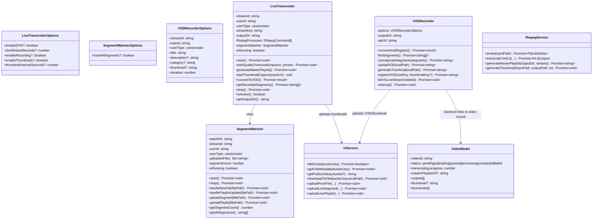
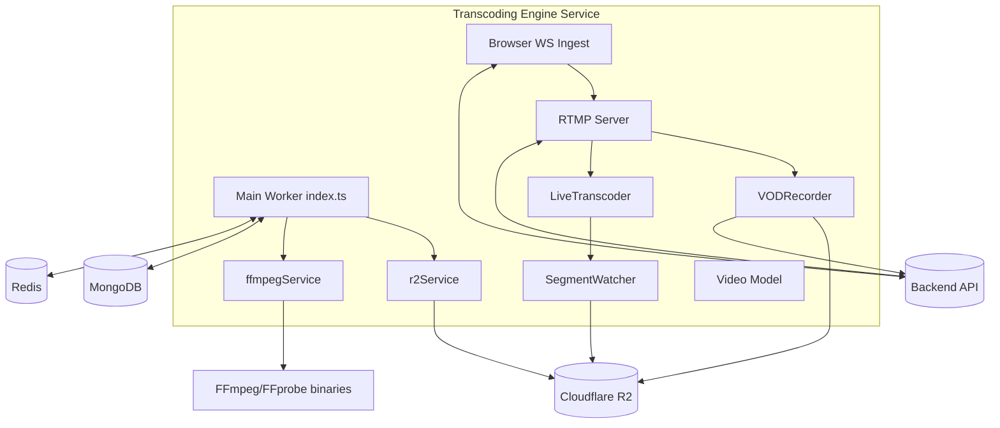
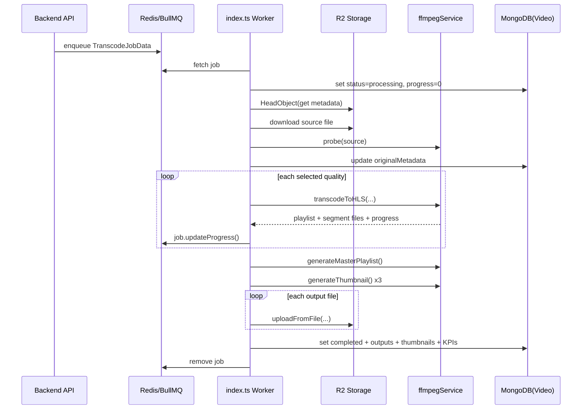
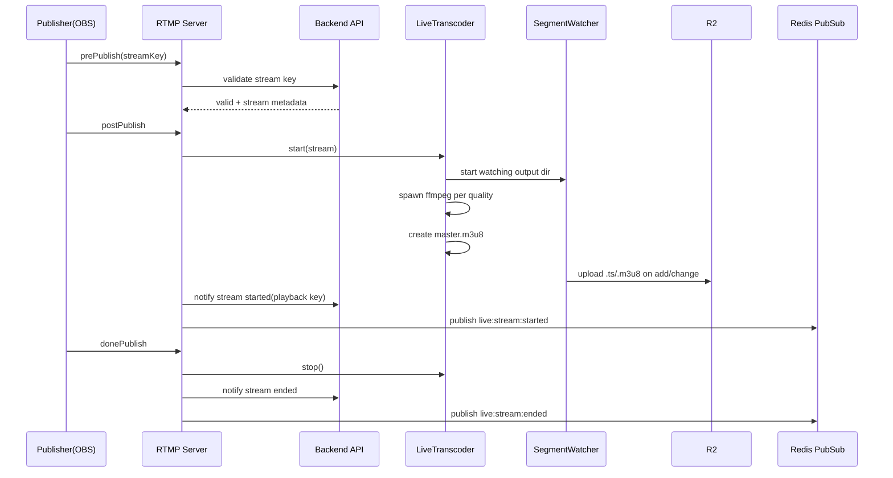
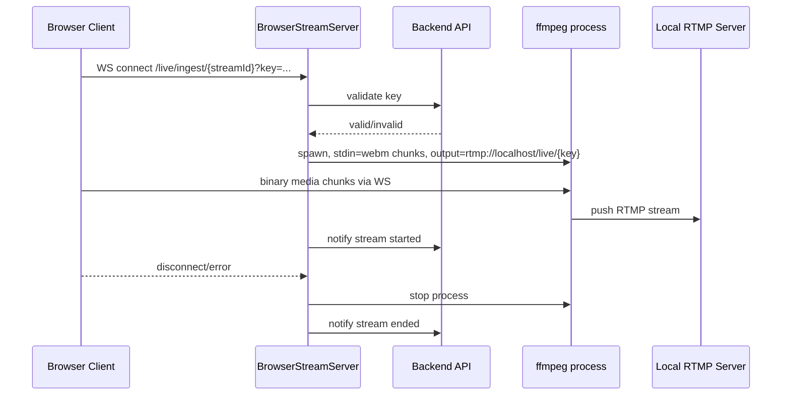
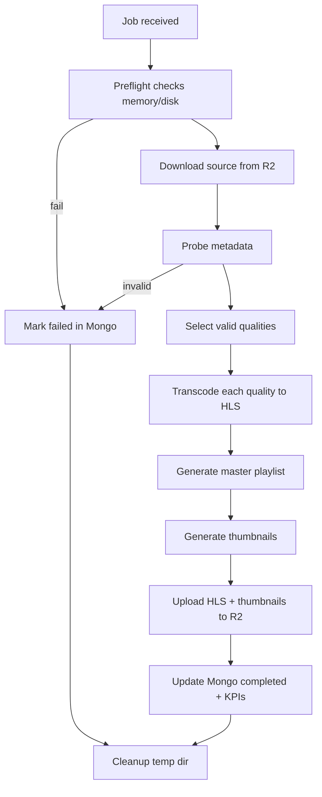

# Transcoding Engine: Comprehensive Technical Documentation

## 1. Scope and Intent
This document is a full-system reference for `transcoding-engine` in this repository. It covers:
- Architecture and module responsibilities
- VOD queue-based transcoding flow
- Live streaming flow (RTMP + browser ingest)
- Data model and contracts
- All classes/functions and their use cases
- Infrastructure/dependency usage
- Environment variables, deployment, and operations
- UML-style diagrams (component, class, sequence, activity)

Primary code root: `transcoding-engine/src`

## 2. Repository Inventory

### 2.1 Top-level files
- `transcoding-engine/package.json`: scripts/deps/runtime profile
- `transcoding-engine/tsconfig.json`: strict TS ESNext build config
- `transcoding-engine/Dockerfile`: containerized runtime with FFmpeg
- `transcoding-engine/railway.toml`: Railway deploy settings
- `transcoding-engine/README.md`: project overview and runbook

### 2.2 Source tree
- `transcoding-engine/src/index.ts`: main worker entrypoint, VOD pipeline orchestration, shutdown
- `transcoding-engine/src/config/database.ts`: MongoDB connect/disconnect
- `transcoding-engine/src/config/redis.ts`: Redis config + shared Redis connection
- `transcoding-engine/src/config/r2.ts`: Cloudflare R2 (S3-compatible) client/bucket config
- `transcoding-engine/src/models/Video.ts`: Mongoose schema for video records
- `transcoding-engine/src/types/index.ts`: queue job payload type(s)
- `transcoding-engine/src/services/ffmpegService.ts`: probing/transcoding/thumbnail primitives
- `transcoding-engine/src/services/r2Service.ts`: R2 file operations (download/upload/metadata)
- `transcoding-engine/src/live/index.ts`: live module re-exports
- `transcoding-engine/src/live/rtmpServer.ts`: RTMP ingest server + stream lifecycle hooks
- `transcoding-engine/src/live/browserStreamServer.ts`: WebSocket ingest for browser streams
- `transcoding-engine/src/live/liveTranscoder.ts`: live HLS transcoding + segment watch + thumbnails
- `transcoding-engine/src/live/segmentWatcher.ts`: filesystem watcher for HLS outputs and uploads
- `transcoding-engine/src/live/vodRecorder.ts`: convert recorded live stream segments to VOD and register in backend

## 3. Runtime Modes

### 3.1 VOD Worker mode (default)
- Starts BullMQ worker(s) for queues:
  - `user-transcode-queue` (always)
  - `creator-transcode-queue` (optional via `ENABLE_CREATOR_WORKER=true`)
- Pulls source media from R2
- Probes/transcodes to HLS qualities
- Uploads outputs + thumbnails
- Updates MongoDB video status and progress

### 3.2 Live mode (optional)
Enabled with `ENABLE_LIVE_WORKER=true`:
- Starts RTMP ingest (`node-media-server`) on `RTMP_PORT` (default 1935)
- Starts browser WebSocket ingest on `BROWSER_STREAM_PORT` (default 8080)
- Runs live transcoding and segment upload pipeline
- Notifies backend stream start/end
- Optionally records and creates VOD post stream

## 4. High-Level Architecture

```mermaid
flowchart LR
  ClientUploader[Backend API / uploader] -->|Enqueue job| Redis[(Redis / BullMQ)]
  Redis --> Worker[Transcoding Engine Worker]
  Worker -->|Download source| R2Raw[(R2 Raw Bucket)]
  Worker -->|FFprobe/FFmpeg| Temp[/tmp/videomanch-transcoding]
  Worker -->|Upload HLS + master| R2Transcoded[(R2 Transcoded Bucket)]
  Worker -->|Upload thumbnails| R2Thumbs[(R2 Thumbnails Bucket)]
  Worker -->|Status/progress| Mongo[(MongoDB Video Collection)]

  OBS[OBS/RTMP Publisher] --> RTMP[RTMP Server]
  Browser[Browser WebSocket Publisher] --> BrowserWS[Browser Stream Server]
  BrowserWS --> RTMP
  RTMP --> LiveTranscoder[LiveTranscoder]
  LiveTranscoder --> SegmentWatcher
  SegmentWatcher --> R2Transcoded
  RTMP -->|start/end callbacks| Backend[Backend API]
  RTMP -->|post-stream| VODRecorder
  VODRecorder --> R2Transcoded
  VODRecorder --> Backend
```

## 5. Core Data Contracts

### 5.1 Queue payload
File: `transcoding-engine/src/types/index.ts`

```ts
interface TranscodeJobData {
  videoId: string;
  userId: string;
  userType: 'user' | 'creator';
  r2Key: string;
  qualities: string[];
}
```

Use case:
- Contract between backend enqueue logic and transcoding engine worker.

### 5.2 Mongo Video model
File: `transcoding-engine/src/models/Video.ts`

Key persisted areas:
- Identity and ownership: `videoId`, `userId`, `userType`
- Source metadata: `originalFile`, `originalMetadata`
- Lifecycle state: `status`, `transcoding.progress/error/timestamps`
- Output references:
  - `masterPlaylistUrl` (R2 key)
  - `outputs[]` (quality variant metadata)
  - `thumbnail`, `thumbnails[]`
- KPIs:
  - timings (`download`, `transcode`, `upload`, `total`)
  - sizes (`original`, each quality, `total`)

Important indexes:
- `videoId` unique
- `userId + status`
- `contentType`, `tags`, `genres`, `createdAt`

## 6. Module Responsibilities and Function-Level Reference

## 6.1 `src/index.ts` (Main Orchestrator)

Purpose:
- Bootstraps DB/Redis workers
- Executes full VOD transcode pipeline per job
- Reports progress and updates Mongo status
- Handles safe shutdown and crash events

Constants / policy controls:
- `MIN_REQUIRED_DISK_SPACE_MULTIPLIER=3`
- `MIN_FREE_DISK_BYTES=500MB`
- `MEMORY_THRESHOLD_PERCENT=85`
- `PROGRESS_UPDATE_INTERVAL_MS=2000`
- `FFMPEG_TIMEOUT_MS=60min` (declared, not currently passed downstream)
- `QUALITY_PRESETS` includes `1080p,720p,480p,360p,240p`

Top-level functions and use cases:
- `getAvailableDiskSpace(targetPath)`
  - Use case: preflight disk capacity validation for temp processing.
- `checkMemoryUsage()`
  - Use case: prevent starting heavy jobs under high memory pressure.
- `sleep(ms)`
  - Use case: retry backoff and memory wait pacing.
- `withRetry(fn,maxRetries,baseDelayMs,operationName)`
  - Use case: resilient R2 network operations.
- `createThrottledProgressReporter(job, updateVideoProgress, videoId)`
  - Use case: avoid Redis/Mongo overload from excessive progress writes.
- `parseFps(fpsString)`
  - Use case: safe numeric parse for ffprobe FPS values (`30/1`, `30000/1001`, decimal).
- `processJob(job)`
  - Use case: end-to-end VOD process for one BullMQ job:
    1. Preflight memory/disk and stale-dir cleanup
    2. Mark Mongo status `processing`
    3. Download original from R2
    4. FFprobe metadata extraction + validation
    5. Smart quality filtering (no upscale)
    6. Per-quality HLS transcode
    7. Master playlist generation
    8. Multi-thumbnail generation
    9. Upload all HLS files + thumbnails
    10. Finalize Mongo status `completed` or `failed`
    11. Remove job from Redis (best effort)
    12. Cleanup temp directory in `finally`
- `updateVideoProgress(videoId, progress)`
  - Use case: Mongo progress updates.
- `gracefulShutdown(signal)`
  - Use case: controlled worker pause/close + connection cleanup.
- `startWorker()`
  - Use case: startup sequence for DB/Redis workers and optional live servers.

Events handled:
- process: `uncaughtException`, `unhandledRejection`, `SIGTERM`, `SIGINT`
- worker: `completed`, `failed`, `error`, `stalled`

## 6.2 `src/services/ffmpegService.ts`

Purpose:
- Encapsulates FFmpeg/FFprobe operations for VOD pipeline.

Types:
- `QualityPreset`
- `HLSOutput`

Functions and use cases:
- `probe(inputPath)`
  - Use case: extract metadata (duration, streams, codecs, fps).
- `transcodeToHLS(inputPath, outputDir, quality, preset, onProgress?, timeoutMs?)`
  - Use case: quality-specific HLS output generation (`.m3u8` + `.ts`).
  - Implements stuck-process timeout and progress callback.
- `generateMasterPlaylist(outputDir, variants)`
  - Use case: adaptive HLS manifest referencing all variants.
- `generateThumbnail(inputPath, outputPath, timestampSeconds=2)`
  - Use case: preview image generation.

Operational notes:
- Accepts `FFMPEG_PATH` and `FFPROBE_PATH` overrides.
- Uses x264/aac and padded scaling strategy.

## 6.3 `src/services/r2Service.ts`

Purpose:
- R2 object IO abstraction (S3 API).

Functions and use cases:
- `fileExists(bucket,key)`
  - Use case: existence checks via `HeadObject`.
- `getFileMetadata(bucket,key)`
  - Use case: source size/content type preflight before download.
- `getPublicUrl(key,bucket?)`
  - Use case: compute CDN/public URL.
- `downloadToFile(bucket,key,localPath)`
  - Use case: stream original upload into temp filesystem.
- `uploadFromFile(bucket,key,localPath,contentType)`
  - Use case: upload generated artifacts from disk with cache-control policy.
- `uploadLiveSegment(key,content,contentType='video/mp2t')`
  - Use case: upload live TS segments / live artifacts from memory.
- `uploadLivePlaylist(key,content)`
  - Use case: upload live m3u8 playlists with no-cache semantics.

Caching policy:
- `.ts` immutable long-cache
- `.m3u8` short/no-cache depending on flow

## 6.4 `src/config/database.ts`

Functions:
- `connectDatabase()`
  - Use case: initialize Mongo connection from `MONGODB_URI`.
- `disconnectDatabase()`
  - Use case: graceful shutdown connection close.

Event hooks:
- mongoose `disconnected`
- mongoose `error`

## 6.5 `src/config/redis.ts`

Functions:
- `parseRedisUrl(url)`
  - Use case: decompose URL into BullMQ-compatible host/port/auth config.
- `getRedisConfig()`
  - Use case: queue worker connection options (with optional TLS).
- `getRedisConnection()`
  - Use case: singleton Redis connection for pub/sub and non-BullMQ operations.
- `disconnectRedis()`
  - Use case: safe quit on shutdown.

## 6.6 `src/config/r2.ts`

Functions/constants:
- `getR2Client()`
  - Use case: singleton S3 client for Cloudflare R2 endpoint.
- `R2_BUCKETS`
  - Use case: centralized bucket names with env fallback defaults.

## 6.7 `src/live/rtmpServer.ts`

Purpose:
- RTMP ingest lifecycle controller and live-session coordinator.

Key contract:
- `StreamSession`

Functions and use cases:
- `validateStreamKey(streamKey)`
  - Use case: authorize incoming ingest via backend API.
- `notifyStreamStarted(streamId, playbackR2Key)`
  - Use case: backend stream state transition (live started).
- `notifyStreamEnded(streamId)`
  - Use case: backend stream state transition (live ended).
- `createRtmpServer()`
  - Use case: instantiate/configure NodeMediaServer and bind event hooks.
- `getActiveSessionsCount()`
  - Use case: operational introspection.
- `getActiveSession(streamId)`
  - Use case: operational introspection by logical stream id.

Event hooks inside `createRtmpServer()`:
- `prePublish`: validate key and accept/reject session
- `postPublish`: instantiate/start `LiveTranscoder`, notify backend, publish Redis event
- `donePublish`: stop transcoder, notify backend, publish Redis event, optionally trigger `VODRecorder`
- `prePlay`, `donePlay`: viewer connect/disconnect logging

## 6.8 `src/live/browserStreamServer.ts`

Purpose:
- Browser-native live ingest using WebSocket binary chunks converted to RTMP via FFmpeg process.

Internal session type:
- `BrowserStreamSession`

Functions and use cases:
- `validateStreamKey(streamId, streamKey)`
  - Use case: browser ingest auth against backend.
- `notifyStreamStarted(streamId, playbackR2Key)`
  - Use case: backend stream start state sync.
- `notifyStreamEnded(streamId)`
  - Use case: backend stream end state sync.
- `startFFmpegProcess(session)`
  - Use case: transcode stdin WebM stream to RTMP FLV output.
- `cleanupSession(streamId)`
  - Use case: kill ffmpeg, notify backend, remove session.
- `createBrowserStreamServer(port)`
  - Use case: WebSocket server setup, route validation, session lifecycle.
- `getActiveBrowserSessionsCount()`
  - Use case: operational introspection.

## 6.9 `src/live/liveTranscoder.ts`

Purpose:
- Real-time multi-bitrate HLS generation for live stream sessions.

Types:
- `LiveQualityPreset`
- `LIVE_QUALITY_PRESETS` (`1080p/720p/480p`)
- `LiveTranscoderOptions`

Class `LiveTranscoder` methods and use cases:
- `start()`
  - Use case: initialize output dirs, start `SegmentWatcher`, start per-quality ffmpeg pipelines, start periodic thumbnails, create master manifest.
- `startQualityTranscode(inputUrl, preset)` (private)
  - Use case: one quality pipeline with HLS flags (DVR/recording mode aware).
- `generateMasterPlaylist()` (private)
  - Use case: live adaptive manifest generation.
- `startThumbnailCapture(inputUrl)` (private)
  - Use case: periodic snapshots uploaded as `thumb_latest.jpg` + numbered versions.
- `convertToVOD()`
  - Use case: concatenate recorded segments into a local MP4 VOD (utility path).
- `getRecordedSegments()`
  - Use case: retrieve local TS list for downstream handling.
- `stop()`
  - Use case: terminate ffmpeg processes, stop watcher, optional cleanup.
- `isActive()`
  - Use case: health/introspection.
- `getOutputDir()`
  - Use case: path exposure for diagnostics/processing.

## 6.10 `src/live/segmentWatcher.ts`

Purpose:
- Watches local live output directory and uploads new/updated artifacts to R2.

Types:
- `SegmentWatcherOptions`

Class `SegmentWatcher` methods and use cases:
- `start()`
  - Use case: start chokidar and bind add/change/error handlers.
- `stop()`
  - Use case: close watcher and finalize stats.
- `handleNewFile(filePath)` (private)
  - Use case: route newly created file to segment/playlist upload.
- `handlePlaylistUpdate(filePath)` (private)
  - Use case: refresh uploaded m3u8 on changes.
- `uploadSegment(filePath)` (private)
  - Use case: upload `.ts`, publish Redis `live:segment:uploaded` event.
- `uploadPlaylist(filePath)` (private)
  - Use case: upload `.m3u8` with no-cache policy.
- `getR2Key(fileName)` (private)
  - Use case: consistent live key path creation.
- `getSegmentCount()`
  - Use case: reporting.
- `getAllSegments()`
  - Use case: recorded segment retrieval for conversion.

## 6.11 `src/live/vodRecorder.ts`

Purpose:
- Post-live conversion from recorded HLS segments into VOD asset + backend registration.

Type:
- `VODRecorderOptions`

Class `VODRecorder` methods and use cases:
- `convertAndRegister()`
  - Use case: orchestrates full post-stream VOD workflow.
- `findSegments()` (private)
  - Use case: discover/sort `720p_*.ts` source segments.
- `concatenateSegments(segments)` (private)
  - Use case: generate MP4 from ordered segment list.
- `uploadVOD(vodPath)` (private)
  - Use case: push VOD file to R2.
- `generateThumbnail(vodPath)` (private)
  - Use case: create/upload thumbnail if not provided.
- `registerVOD(vodKey, thumbnailKey?)` (private)
  - Use case: backend API registration of created VOD.
- `linkToLiveStream(videoId)` (private)
  - Use case: connect resulting VOD with original live stream record.
- `cleanup()` (private)
  - Use case: delete local output unless retention is enabled.

## 7. UML/Class Diagrams

### 7.1 Class diagram


### 7.2 Component/deployment diagram


## 8. Sequence Diagrams

### 8.1 VOD transcode job sequence


### 8.2 Live RTMP stream sequence


### 8.3 Browser ingest sequence


## 9. Activity Diagrams

### 9.1 VOD job activity


## 10. Dependency and Library Usage

External dependencies (`package.json`) and concrete use:
- `bullmq`
  - Queue workers, job lifecycle/progress handling.
- `ioredis`
  - Redis connectivity for BullMQ config and pub/sub events.
- `mongoose`
  - Video schema/model persistence and status tracking.
- `fluent-ffmpeg`
  - FFprobe metadata extraction, HLS and MP4 transcoding, thumbnails.
- `@aws-sdk/client-s3`
  - Cloudflare R2 object operations via S3-compatible API.
- `@aws-sdk/s3-request-presigner`
  - Imported but not currently used in implementation.
- `axios`
  - Internal backend webhook/API calls (stream validate/start/end, VOD register/link).
- `node-media-server`
  - RTMP ingest server and stream event hooks.
- `ws`
  - Browser live ingest WebSocket server.
- `chokidar`
  - Filesystem watch for newly generated live HLS artifacts.
- `dotenv`
  - Environment loading.

Node built-ins used:
- `fs/promises`, `fs` streams: local temp IO
- `path`, `os`: temp paths and platform resource checks
- `child_process`: disk-space shell call (`df`) and browser-ingest ffmpeg spawn
- `stream/promises`, `stream`: upload/download pipeline

## 11. Environment Variables (Complete)

Core:
- `MONGODB_URI`
- `REDIS_URL`
- `ENABLE_CREATOR_WORKER`
- `ENABLE_LIVE_WORKER`

FFmpeg:
- `FFMPEG_PATH`
- `FFPROBE_PATH`

R2 credentials/buckets/public URLs:
- `R2_ACCOUNT_ID`
- `R2_ACCESS_KEY_ID`
- `R2_SECRET_ACCESS_KEY`
- `R2_BUCKET_RAW`
- `R2_BUCKET_TRANSCODED`
- `R2_BUCKET_THUMBNAILS`
- `R2_BUCKET_LIVE`
- `R2_PUBLIC_URL`
- `R2_PUBLIC_URL_THUMBNAILS`

Live ingest/server/webhooks:
- `RTMP_PORT`
- `RTMP_HTTP_PORT`
- `BROWSER_STREAM_PORT`
- `LIVE_SEGMENTS_DIR`
- `BACKEND_URL`
- `INTERNAL_WEBHOOK_SECRET`

VOD recorder / backend auth:
- `API_URL`
- `INTERNAL_API_KEY`
- `KEEP_LIVE_RECORDINGS`

## 12. Storage and Pathing Conventions

VOD temp workspace:
- `${os.tmpdir()}/videomanch-transcoding/{videoId}`

Live temp workspace:
- `${LIVE_SEGMENTS_DIR || /tmp/live-segments}/{streamId}`

R2 key patterns:
- VOD outputs: `{userType}/{userId}/{videoId}/{quality}.m3u8`, segment `.ts`, `master.m3u8`
- Thumbnails: `{userType}/{userId}/{videoId}/thumbnail_{n}.jpg`
- Live: `live/{userType}/{userId}/{streamId}/...`
- VOD-from-live: `{userType}/{userId}/vod/{streamId}/video.mp4` and `/thumbnail.jpg`

## 13. Reliability and Operational Design

What the engine does for resilience:
- Exponential retry wrapper for network-heavy operations
- Memory and disk-space guardrails before processing
- Throttled progress updates
- Stalled-job recovery options in BullMQ worker config
- Graceful shutdown waits for active jobs before closure
- Local temp cleanup in `finally`

Potentially notable implementation nuances:
- `FFMPEG_TIMEOUT_MS` is declared in `index.ts` but the call path currently uses service default timeout unless explicitly passed.
- `getSignedUrl` is imported in `r2Service.ts` but currently unused.
- Live startup logs fixed RTMP port values in console while actual ports are env-driven.

## 14. End-to-End Use Cases

### Use case A: Standard uploaded video transcoding
1. Backend enqueues `TranscodeJobData`.
2. Worker picks job, validates system resources.
3. Downloads source from R2 raw bucket.
4. Probes and validates stream metadata.
5. Generates non-upscaled quality ladder to HLS.
6. Uploads all assets to R2.
7. Stores output references/KPIs in MongoDB.
8. Marks video as completed.

### Use case B: OBS live stream
1. OBS pushes RTMP with stream key.
2. Engine validates stream key with backend.
3. LiveTranscoder creates multi-bitrate live HLS outputs.
4. SegmentWatcher uploads segments/manifests continuously.
5. Backend notified of start/end.
6. Optional VOD conversion after stream ends.

### Use case C: Browser live stream
1. Browser sends WebM chunks over WebSocket.
2. Engine validates credentials.
3. Spawned FFmpeg converts incoming chunks to RTMP.
4. RTMP pipeline then follows same live transcoding path.

## 15. Quick File-by-File Cheat Sheet

- `src/index.ts`: master orchestrator for VOD + optional live server startup
- `src/services/ffmpegService.ts`: media transforms and metadata extraction
- `src/services/r2Service.ts`: storage ingress/egress and metadata lookups
- `src/models/Video.ts`: persistence shape for processing lifecycle and outputs
- `src/live/rtmpServer.ts`: ingest auth/lifecycle and event fanout
- `src/live/browserStreamServer.ts`: browser ingest adapter
- `src/live/liveTranscoder.ts`: live HLS production engine
- `src/live/segmentWatcher.ts`: local-to-R2 live artifact replication
- `src/live/vodRecorder.ts`: post-live archival VOD creation + backend registration

## 16. Suggested Reading Order for New Engineers
1. `src/index.ts` (worker lifecycle and processJob)
2. `src/services/ffmpegService.ts`
3. `src/services/r2Service.ts`
4. `src/models/Video.ts`
5. `src/live/rtmpServer.ts`
6. `src/live/liveTranscoder.ts`
7. `src/live/segmentWatcher.ts`
8. `src/live/browserStreamServer.ts`
9. `src/live/vodRecorder.ts`

---
This document is based on the current repository state under `transcoding-engine` and is intended as an engineering deep dive/reference baseline.
